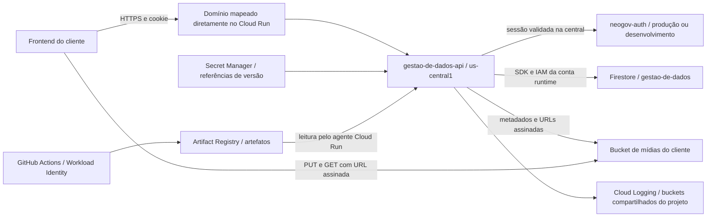

# Componentes de Gestão de Dados — API

Inventário baseado no README fornecido e em consultas GCP em 29/10/2026. O [README.md](README.md) foi copiado integralmente; suas instruções de implantação foram tratadas como documentação. O estado implantado prevalece nas conclusões abaixo.

## Fluxo e dependências

O diagrama descreve o fluxo documentado e os vínculos configurados. Não foram executados login, chamadas funcionais, leitura/escrita de documentos ou uploads.

| Componente | Papel e estado encontrado | Relevância de custo |
| --- | --- | --- |
| Cloud Run | 23 serviços NestJS, porta 8080, 1 vCPU e 1 GiB; configuração completa no inventário | CPU, memória, requisições e transferência, conforme SKUs efetivos |
| Firestore | Um banco nomeado `gestao-de-dados` por instalação, Native/Standard, `us-central1`; quatro índices `complaints` READY em cada banco | Leituras, escritas, exclusões, armazenamento, índices, backups e transferência |
| Cloud Storage | Um bucket configurado por instalação, STANDARD em US-CENTRAL1, acesso uniforme e prevenção de acesso público enforced | Armazenamento, operações, transferência e dados retidos por soft delete |
| Secret Manager | 22 instalações referenciam `NEOGOV_AUTH_API_KEY` e `NEOGOV_AUTH_ALLOWED_ISSUERS` por `latest`; `lgpdweb` usa `neogov-auth-api-key:1` | Versões ativas, acessos e eventual replicação; não foram lidos valores |
| Conta de execução | `gestao-de-dados-api-runtime@PROJETO.iam.gserviceaccount.com` | Define acessos SDK e assinatura de URLs; ver matriz IAM |
| neogov-auth | QA: `https://api.auth-develop.neogov.com.br`; demais: `https://api.auth.neogov.com.br` | Dependência externa ao escopo de inspeção; custo da central não apurado nem rateado |
| Artifact Registry | Repositório central `artefatos/us-central1/gestao-de-dados-api`, imagem fixada por digest | Armazenamento, transferência e análise de vulnerabilidades; compartilhado entre instalações |
| Domínio e TLS | 23 mapeamentos diretos de domínio no Cloud Run, certificados provisionados e Ready=True | Não foi identificada dependência de balanceador para esses mapeamentos; DNS externo não auditado |
| Cloud Logging | Sinks locais para `_Default` e `_Required`; retenções consultadas de 30 e 400 dias | Ingestão/retenção são por bucket e podem misturar aplicações; não atribuir todo o projeto à API |

## Configuração e segurança observadas

Todos os serviços têm `ingress=all` e `run.googleapis.com/invoker-iam-disabled=true`. A invocação pública é permitida sem checagem IAM Google, mesmo com política do serviço sem `allUsers`. O README descreve validação de cookie na neogov-auth; essa validação não foi testada. Exposição de `/docs` e `/docs-json` também não foi testada.

22 serviços têm limites configurados de 100 instâncias no serviço e revisão. `lgpdweb` limita o serviço a 3. Não foi encontrada configuração de mínimo positivo. Esses são limites configurados, não medições de instâncias nem garantia de teto financeiro. O timeout da central é 20.000 ms em 22 instalações e 5.000 ms em `lgpdweb`.

22 bancos têm agenda semanal de backup aos domingos, retenção de 98 dias; `lgpdweb` não possui agenda. Agenda configurada não comprova backup já produzido ou restauração válida. Todos os 23 bancos têm PITR e proteção contra exclusão desabilitados; todos informam `freeTier=false`.

Todos os buckets de mídias têm soft delete de 7 dias no estado coletado. A maioria configura cache CORS de 3.600 segundos; o README sugere 300. As origens estão registradas por instalação no JSON. Não foram lidos objetos ou comprovados uploads pelo navegador.

Não foram encontrados conectores VPC/Direct VPC ou configuração especial de egress nas configurações dos 23 serviços. As listagens Compute de 21 projetos retornaram vazias para NEGs, backends, URL maps e forwarding rules; em `cides-lgpdweb` e QA a API Compute está desabilitada e as consultas falharam. Ela não foi habilitada. Isso não descarta infraestrutura ou DNS em outros projetos.

## Permissões e diferenças a revisar

As concessões da conta runtime estão em [permissoes.md](permissoes.md). Em 22 projetos o papel Firestore é concedido sem condição de banco e alcança outros bancos do projeto; `lgpdweb` possui condição ao banco `gestao-de-dados`. QA também concede `roles/run.editor` e `roles/secretmanager.secretAccessor` no projeto. O escopo desses papéis é maior que o descrito para o funcionamento normal da API. Nenhuma concessão foi alterada.

Quase todas as referências de segredos usam `latest`, em desacordo com a recomendação de versão numérica do README. A troca da versão apontada por `latest` pode afetar novas instâncias; uma reversão de revisão pode continuar dependendo do valor resolvido no segredo. Não foi feita rotação nem leitura de payload.

O publicador central aceita Workload Identity de vários repositórios GitHub, incluindo `neogovbr/gestao-de-dados-api`. Assim, a identidade de publicação é compartilhada. O agente gerenciado de Cloud Run de cada um dos 23 projetos possui leitura no repositório central. A conta runtime de QA também possui leitura no repositório.

## Limites

O levantamento cobre os 26 projetos visíveis com LGPDWeb no nome/ID e o repositório central em `artefatos`. Projetos inacessíveis ou com outros nomes podem existir. Não se trata de teste de disponibilidade funcional nem de auditoria completa de todas as permissões efetivas. Herança, políticas Deny, participação em grupos e mudanças durante a coleta podem alterar o resultado.

Veja [inventario.md](inventario.md), [inventario.json](inventario.json) e [custos.md](custos.md).

## Consulta delimitada — São João del-Rei, 12/11/2026

Projeto `pm-sao-joao-del-rei-mg` ativo, número `971507433447`, consultado em 2026-11-12T09:43:11.847877-03:00. Ambiente não confirmado pelo usuário; implantação ainda não iniciada. O projeto não integrava o levantamento de 29/10. Foram listados 8 serviços Cloud Run em `us-central1`, nenhum com nome `gestao-de-dados-api`; outros nomes não comprovam equivalência funcional. O único banco listado é `modules`, Native/Standard em `us-central1`. Não existe banco listado `gestao-de-dados`.

Não foram encontradas conta `gestao-de-dados-api-runtime` nem entradas no Secret Manager. Os 5 buckets listados são de funções, anonimização, backup e Firebase Storage; nenhum tem nome dedicado de Gestão de Dados, mas não foi inspecionado conteúdo nem excluído uso compartilhado. As 6 APIs do roteiro de implantação estão habilitadas. Nenhuma configuração, coleção, objeto ou payload de segredo foi lido; nenhuma mudança no GCP foi executada.

Proposta: instalação dedicada de API, banco e bucket; origem do frontend, domínio, imagem, vínculo neogov-auth, retenção e estratégia de entrada permanecem pendentes. Fonte README preservada; frontend não catalogado por esta consulta. [Evidências e plano](../../solicitacoes/2026-11-12-plano-implantacao-gestao-dados-sao-joao/relatorio.md). Os demais fatos deste documento mantêm suas datas anteriores.

Esclarecimento nesta solicitação: somente API e infraestrutura; origem do frontend informada `https://pmsaojoaodelreimg.gestaodedados.neogov.com.br`. Usuário criará o vínculo neogov-auth e preencherá os segredos posteriormente. API, segredos e variáveis ainda não criados/aplicados no GCP; domínio da API apenas proposto no plano.

## Infraestrutura preparada — São João del-Rei, 12/11/2026

Atualização em 2026-11-12T09:59:10.373973-03:00. Após o diagnóstico inicial, o usuário confirmou produção, `us-central1` e hostname `api.pmsaojoaodelreimg.gestaodedados.neogov.com.br`; escopo limitado à API e infraestrutura. Foram criados a conta runtime dedicada, banco `gestao-de-dados` Native/Standard com proteção contra exclusão, quatro índices `complaints` agora READY, bucket `gestao-de-dados-pm-sao-joao-del-rei-mg` privado e os recursos Secret Manager `NEOGOV_AUTH_API_KEY` e `NEOGOV_AUTH_ALLOWED_ISSUERS`, ambos sem versões. A ausência descrita na consulta inicial é histórica e foi sucedida por esta preparação autorizada.

O bucket está em US-CENTRAL1/STANDARD, com acesso uniforme, prevenção de acesso público enforced, soft delete de 7 dias e CORS GET/PUT exclusivamente para `https://pmsaojoaodelreimg.gestaodedados.neogov.com.br`, headers Content-Type/x-goog-if-generation-match e cache 300 s. A runtime tem Firestore condicionado ao novo banco, acesso de criação/leitura de objetos no bucket, assinatura na própria conta e leitura somente dos dois novos segredos pelas concessões adicionadas. Não existem chaves gerenciadas pelo usuário na runtime. Permissões anteriores do projeto e bindings padrão do bucket foram preservados; privacidade contra acesso público não significa isolamento de administradores ou contas com acesso amplo no projeto.

**Não há serviço Cloud Run desta instalação criado.** Env e template foram preparados localmente, com marcadores explícitos de imagem/versões. Usuário criará o vínculo neogov-auth e preencherá os segredos; depois serão necessários release por digest, acesso ao repositório central, deploy, entrada DNS/TLS e homologação. Backup/PITR não foram ativados; política de recuperação pendente antes de dados reais. Não foram lidos dados de negócio ou payloads, executados testes funcionais ou alterados `modules` e serviços existentes. [Relatório de execução e evidências](../../solicitacoes/2026-11-12-plano-implantacao-gestao-dados-sao-joao/execucao-aprovada/relatorio.md).

## Preenchimento dos segredos — São João del-Rei, 12/11/2026

Em 2026-11-12T10:05:48.603568-03:00, adicionadas e verificadas por metadados as versões `NEOGOV_AUTH_API_KEY:1` e `NEOGOV_AUTH_ALLOWED_ISSUERS:1`, ambas ENABLED, no projeto `pm-sao-joao-del-rei-mg`. Chave fornecida pelo usuário sem registro do valor; emissor exato indicado pelo usuário: `https://api.auth.neogov.com.br` (sem barra final). Nenhum payload lido na verificação. Este estado sucede os registros anteriores de segredos sem versões. IAM não alterado; vínculo tenant/sistema e validação funcional ainda não comprovados. Template local atualizado nesta solicitação para referências fixas `:1`, mantendo a imagem pendente; não houve deploy. [Relatório do preenchimento](../../solicitacoes/2026-11-12-preencher-segredos-gestao-dados-sao-joao/relatorio.md).

## API publicada — São João del-Rei, 12/11/2026

Estado verificado em 2026-11-12T10:20:22.124691-03:00: serviço `gestao-de-dados-api`, us-central1, revisão `gestao-de-dados-api-00002-l6h` Ready e com 100% do tráfego. Imagem observada nas tags master/latest/2.0.0, fixada por digest `sha256:d7f64a47030cbccad5cc5a7b4ae16ae95158651fe1548f8a364c5d6a3ea3c505`. O digest de plataforma resolvido pela revisão difere do índice OCI; a correspondência linux/amd64 foi comprovada pelo manifesto do repositório, sem alteração da imagem. Proveniência de build/assinatura não foi retornada pelo repositório e não foi inventada.

Recursos: 1 vCPU, 1 GiB, porta 8080, concorrência 80, timeout HTTP 300 s, mínimo 0/máximo 3; referências de segredos fixas `NEOGOV_AUTH_API_KEY:1` e `NEOGOV_AUTH_ALLOWED_ISSUERS:1`. Timeout da central aumentado de 5000 para 20000 ms após falha transitória de aproximadamente 5 s, como mitigação; causa da lentidão inicial não comprovada. Cookie Secure/lax, origem do frontend mantida.

Invocação HTTP pública com ingresso all e checagem IAM desabilitada; política do serviço sem allUsers não significa serviço privado. A documentação respondeu 200; sem sessão ou com cookie deliberadamente inválido, /auth/self e /complaints responderam 401. Preflight CORS 204 para a origem informada. A consulta de erros na revisão final retornou vazia, limitada ao intervalo e limite da evidência. Isso não prova disponibilidade contínua, login válido, CRUD, uploads ou restauração.

URL padrão disponível: `https://gestao-de-dados-api-971507433447.us-central1.run.app`. Domínio `api.pmsaojoaodelreimg.gestaodedados.neogov.com.br` mapeado, DomainRoutable=True, Ready/CertificateProvisioned=Unknown/CertificatePending na última leitura. CNAME externo necessário: `api.pmsaojoaodelreimg.gestaodedados` → `ghs.googlehosted.com.` na zona neogov.com.br, servida por pajehost. DNS/TLS ainda não concluídos; não usar a URL run.app como substituição silenciosa no frontend, pois o cookie lax depende do site final. Frontend não alterado. [Relatório do deploy](../../solicitacoes/2026-11-12-deploy-gestao-dados-sao-joao/relatorio.md).
