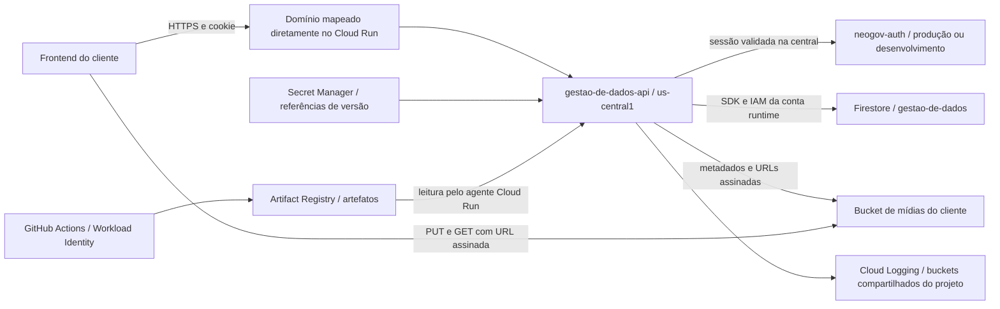

# Componentes de Gestão de Dados — API

Inventário baseado no README fornecido e em consultas GCP em 29/10/2026. O [README.md](README.md) foi copiado integralmente; suas instruções de implantação foram tratadas como documentação. O estado implantado prevalece nas conclusões abaixo.

## Fluxo e dependências

O diagrama descreve o fluxo documentado e os vínculos configurados. Não foram executados login, chamadas funcionais, leitura/escrita de documentos ou uploads.

| Componente | Papel e estado encontrado | Relevância de custo |
| --- | --- | --- |
| Cloud Run | 23 serviços NestJS, porta 8080, 1 vCPU e 1 GiB; configuração completa no inventário | CPU, memória, requisições e transferência, conforme SKUs efetivos |
| Firestore | Um banco nomeado `gestao-de-dados` por instalação, Native/Standard, `us-central1`; quatro índices `complaints` READY em cada banco | Leituras, escritas, exclusões, armazenamento, índices, backups e transferência |
| Cloud Storage | Um bucket configurado por instalação, STANDARD em US-CENTRAL1, acesso uniforme e prevenção de acesso público enforced | Armazenamento, operações, transferência e dados retidos por soft delete |
| Secret Manager | 22 instalações referenciam `NEOGOV_AUTH_API_KEY` e `NEOGOV_AUTH_ALLOWED_ISSUERS` por `latest`; `lgpdweb` usa `neogov-auth-api-key:1` | Versões ativas, acessos e eventual replicação; não foram lidos valores |
| Conta de execução | `gestao-de-dados-api-runtime@PROJETO.iam.gserviceaccount.com` | Define acessos SDK e assinatura de URLs; ver matriz IAM |
| neogov-auth | QA: `https://api.auth-develop.neogov.com.br`; demais: `https://api.auth.neogov.com.br` | Dependência externa ao escopo de inspeção; custo da central não apurado nem rateado |
| Artifact Registry | Repositório central `artefatos/us-central1/gestao-de-dados-api`, imagem fixada por digest | Armazenamento, transferência e análise de vulnerabilidades; compartilhado entre instalações |
| Domínio e TLS | 23 mapeamentos diretos de domínio no Cloud Run, certificados provisionados e Ready=True | Não foi identificada dependência de balanceador para esses mapeamentos; DNS externo não auditado |
| Cloud Logging | Sinks locais para `_Default` e `_Required`; retenções consultadas de 30 e 400 dias | Ingestão/retenção são por bucket e podem misturar aplicações; não atribuir todo o projeto à API |

## Configuração e segurança observadas

Todos os serviços têm `ingress=all` e `run.googleapis.com/invoker-iam-disabled=true`. A invocação pública é permitida sem checagem IAM Google, mesmo com política do serviço sem `allUsers`. O README descreve validação de cookie na neogov-auth; essa validação não foi testada. Exposição de `/docs` e `/docs-json` também não foi testada.

22 serviços têm limites configurados de 100 instâncias no serviço e revisão. `lgpdweb` limita o serviço a 3. Não foi encontrada configuração de mínimo positivo. Esses são limites configurados, não medições de instâncias nem garantia de teto financeiro. O timeout da central é 20.000 ms em 22 instalações e 5.000 ms em `lgpdweb`.

22 bancos têm agenda semanal de backup aos domingos, retenção de 98 dias; `lgpdweb` não possui agenda. Agenda configurada não comprova backup já produzido ou restauração válida. Todos os 23 bancos têm PITR e proteção contra exclusão desabilitados; todos informam `freeTier=false`.

Todos os buckets de mídias têm soft delete de 7 dias no estado coletado. A maioria configura cache CORS de 3.600 segundos; o README sugere 300. As origens estão registradas por instalação no JSON. Não foram lidos objetos ou comprovados uploads pelo navegador.

Não foram encontrados conectores VPC/Direct VPC ou configuração especial de egress nas configurações dos 23 serviços. As listagens Compute de 21 projetos retornaram vazias para NEGs, backends, URL maps e forwarding rules; em `cides-lgpdweb` e QA a API Compute está desabilitada e as consultas falharam. Ela não foi habilitada. Isso não descarta infraestrutura ou DNS em outros projetos.

## Permissões e diferenças a revisar

As concessões da conta runtime estão em [permissoes.md](permissoes.md). Em 22 projetos o papel Firestore é concedido sem condição de banco e alcança outros bancos do projeto; `lgpdweb` possui condição ao banco `gestao-de-dados`. QA também concede `roles/run.editor` e `roles/secretmanager.secretAccessor` no projeto. O escopo desses papéis é maior que o descrito para o funcionamento normal da API. Nenhuma concessão foi alterada.

Quase todas as referências de segredos usam `latest`, em desacordo com a recomendação de versão numérica do README. A troca da versão apontada por `latest` pode afetar novas instâncias; uma reversão de revisão pode continuar dependendo do valor resolvido no segredo. Não foi feita rotação nem leitura de payload.

O publicador central aceita Workload Identity de vários repositórios GitHub, incluindo `neogovbr/gestao-de-dados-api`. Assim, a identidade de publicação é compartilhada. O agente gerenciado de Cloud Run de cada um dos 23 projetos possui leitura no repositório central. A conta runtime de QA também possui leitura no repositório.

## Limites

O levantamento cobre os 26 projetos visíveis com LGPDWeb no nome/ID e o repositório central em `artefatos`. Projetos inacessíveis ou com outros nomes podem existir. Não se trata de teste de disponibilidade funcional nem de auditoria completa de todas as permissões efetivas. Herança, políticas Deny, participação em grupos e mudanças durante a coleta podem alterar o resultado.

Veja [inventario.md](inventario.md), [inventario.json](inventario.json) e [custos.md](custos.md).
