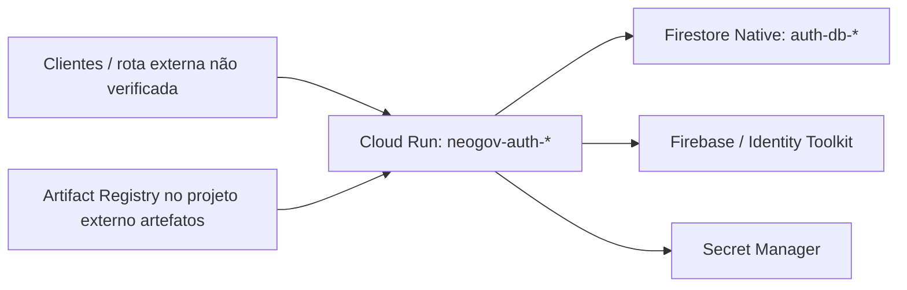

# Componentes — neogov-auth

Coleta em 2026-10-29T23:25:30-03:00 (`America/Sao_Paulo`). Não foi fornecido README ou outra documentação da aplicação; por isso não há `README.md` neste ativo.

## Finalidade e arquitetura observada

O usuário informou que esta é a API de autenticação, em produção no projeto `neogov-auth-prd` e em desenvolvimento no projeto `neogov-auth-dev`. Essa classificação de ambientes é **informada pelo usuário**. A implementação observada em ambos os projetos é um serviço Cloud Run, com um banco Firestore Native local e integração Firebase/Identity Toolkit habilitada.

O diagrama descreve vínculos observados ou inferidos pela configuração; não comprova chamadas, autenticação funcional, rotas, domínio/TLS ou conteúdo armazenado.

| Componente | Estado da verificação | Evidência e limite |
| --- | --- | --- |
| Cloud Run | Observado | Um serviço em `us-central1` por projeto; ambos `Ready` e com 100% do tráfego na revisão mais recente. |
| Firestore | Observado | Bancos Native `auth-db-prd` e `auth-db-dev`; não foram lidos documentos. |
| Firebase / Identity Toolkit | Observado parcialmente | APIs `firebase.googleapis.com` e `identitytoolkit.googleapis.com` habilitadas; configuração de provedores não foi consultada. |
| Secret Manager | Observado | Cinco referências de segredo por instalação; conteúdo e políticas diretas não foram lidos. |
| Imagem/publicação | Observado parcialmente | Imagens vêm de `us-central1-docker.pkg.dev/artefatos/neogov-auth/...`; o projeto `artefatos` não foi consultado. |
| E-mail transacional | Inferido | A referência `ZEPTOMAIL_API_TOKEN` sugere uma integração externa, sem comprovação de uso em execução. |

## Exposição e riscos observados

- Ambos os serviços têm `ingress=all` e `run.googleapis.com/invoker-iam-disabled=true`. A invocação não é controlada pelo IAM do Cloud Run. A política IAM do serviço sem `allUsers` não demonstra privacidade nesse cenário.
- A URL padrão do Cloud Run está desabilitada e o campo de URL retornou vazio. Domínio, balanceador, Firebase Hosting, TLS e controles de borda não foram confirmados.
- `minScale=0` permite escala a zero; há limite máximo de 100 instâncias. Isso é configuração de capacidade, não prova de desempenho nem disponibilidade fim a fim.
- A proteção contra exclusão do Firestore está desabilitada nos dois bancos. Não foi avaliada uma política organizacional de negação, exportação, backup ou restauração.
- As versões atuais estão prontas, mas isso não constitui teste das rotas nem da autenticação. Em histórico de revisões do desenvolvimento foi observado um erro antigo de acesso a segredos em revisão já retirada; a revisão atual está `Ready`.

## Diferenças entre instalações

| Aspecto | Produção | Desenvolvimento |
| --- | --- | --- |
| Imagem | `.../neogov-auth:1.0.1` | `.../neogov-auth:develop` |
| CPU / memória | 4 vCPU / 2 GiB | 2 vCPU / 1 GiB |
| Revisão recebendo tráfego | `neogov-auth-prd-00008-rdp` | `neogov-auth-dev-00025-lhc` |
| Publicador externo | `roles/run.developer` | `roles/run.admin` |

## Pendências

1. Confirmar a rota pública efetiva, domínio, TLS, WAF/CDN e autenticação de borda.
2. Com autorização específica, levantar índices, backups/PITR e políticas diretas dos segredos; a sessão bloqueou essa coleta detalhada por exigir confirmação dos alvos.
3. Verificar configurações de Firebase Authentication (provedores, domínios autorizados e tenants) sem expor credenciais.
4. Confirmar a origem da publicação e permissões no projeto externo `artefatos`, se esse projeto for incluído em uma solicitação futura.
